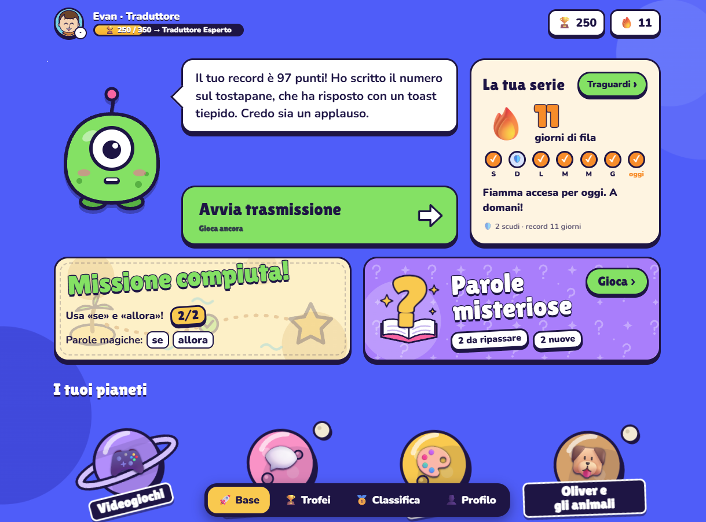

# ZibZib, a game that teaches kids to explain themselves

- URL: https://paolodona.com/blog/zibzib.html
- Published: 5th November 2026 (2026-11-05)
- Summary: I built a speaking game for my ten-year-old. A very confused alien asks questions, you answer out loud, and you get better at explaining things clearly and finding the right word. Here is how it works and why I built it.

Try explaining how to get to the nearest bar to someone who has never seen a street. It is harder than it sounds. You have to set the scene, put things in the right order, connect one step to the next, and resist the urge to say "the thing over there". Most adults I work with still struggle with this, and it is arguably the most useful skill in any job.

So I did what I tend to do when something nags at me: I built something. It is called **[ZibZib](https://zibzib.it)**, it is a speaking game in Italian for my ten-year-old, and its whole purpose is to help kids **explain themselves clearly and learn more words** without ever feeling like homework.

## How it works

Zib is an alien who has just landed on Earth and understands nothing. Each round, Zib asks a question about something the player actually cares about — Minecraft, Super Mario, Among Us, science — or about everyday life: how does the gardener mow the lawn?

There is no timer. You take as long as you like to plan your answer, tap a button, and talk into the microphone. Because Zib genuinely does not get it, a vague answer ("you take it and put it there") earns a puzzled reaction, and the gap in the explanation becomes obvious in a funny, friendly way rather than a corrective one. That turned out to be the core trick: **an alien that doesn't understand is a far better listener than a grown-up with a red pen.**

After each answer the game shows a score split into a few colourful dimensions, then gives exactly three things: **one thing that went well**, **one tip**, and a slightly better version of the player's *own* answer. Then it offers a rematch on the same question for bonus points. A session is three rounds, around ten minutes.

## Words, collected like cards

Every few rounds a face-down card flips and reveals a **mystery word** — something like *sonnolenza*. Zib asks if you know it. If you do, you prove it with a sentence of your own. If you don't, Zib explains it in kid language, reads two examples, and you invent a new sentence.

The word then goes into an album and comes back later. It turns golden when you use it by yourself while explaining something completely different, and that is the moment I care about. The words climb through five levels of difficulty, so they are never obvious and never out of reach.

## Game on the outside, learning on the inside

A few principles I held myself to:

- **Nothing sounds like school.** No questions, marks or tasks. There are trophies, coins, a road of planets and a character to befriend. I borrowed shamelessly from games my son already loves, minus the nasty parts: trophies are never taken away.
- **You only compete with yourself.** Scores track progress against your own earlier answers.
- **How it sounds is never penalised.** The game listens to what you say and how you structure it, not your accent, and English game words are perfectly fine.
- **One thing at a time.** One tip per round, one focus per session.
- **Nothing is hidden.** Recordings are saved, and the player knows that they, and their parents, can listen back.
- **Privacy by default.** It is a child's voice, so I only use services that don't train on it, and the language model only ever sees pseudonymised transcripts.

## Under the hood

It is two small pieces talking over a plain HTTP API. A Python FastAPI engine handles speech-to-text, text-to-speech, grading and storage; a React single-page app handles the microphone and the screen. Azure Speech does the transcription, deliberately keeping the "ehm"s and restarts instead of tidying them up, and Claude grades each answer against a rubric and writes the feedback. It runs on the same small server as [Whatevernote](https://www.whatevernote.com), and I built it with Claude Code, which for a side project with a very short attention budget has been a genuine multiplier.

## What I would tell you if you are building something similar

Start with the narrowest loop that could possibly be fun: ask, answer, react. I resisted building the rewards, the economy and the album until that loop worked, because if a ten-year-old does not want to do it again tomorrow, nothing else matters.

It is built for my family, so it is rough in places, but you are welcome to try it at [zibzib.it](https://zibzib.it). If you have kids, or opinions about teaching language through games, I would love to hear them — drop me a line.
